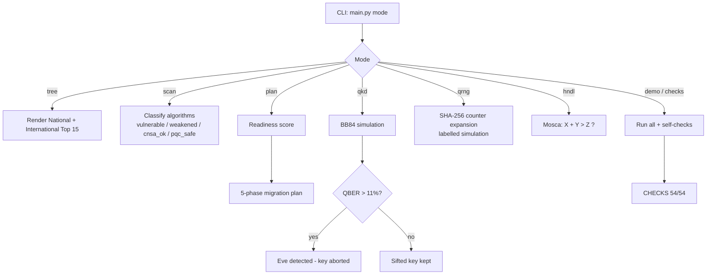
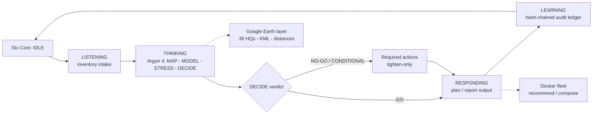

# ACD-Quantum


## What is this?

**ACD-Quantum** is a Quantum Cyber Security structure tree and migration toolkit: the **Top 15 National (USA)** and **Top 15 International** bodies, standards and industry players that govern the post-quantum transition — plus working tools built on that map.

One `main.py`, pure Python standard library, zero dependencies, offline and deterministic. It prints the full structure tree, scans a cryptographic inventory for quantum-vulnerable algorithms, scores PQC migration readiness and generates a phased migration plan, simulates the BB84 quantum key distribution protocol with eavesdropper detection via QBER, simulates a QRNG (honestly labelled as a simulation), and calculates Harvest-Now-Decrypt-Later risk with the Mosca inequality.

The five branches are: **PQC** (NIST FIPS 203 ML-KEM / 204 ML-DSA / 205 SLH-DSA, plus HQC), **QKD**, **QRNG**, **Crypto Discovery / Agility**, and **HNDL Defense**.

**Merged in:** a **Google Earth layer** (real HQ coordinates for all 30 bodies, KML export for Google Earth, haversine distances), the **Gemini Argon 4 Extended Thinking DECIDER** seat (MAP→MODEL→STRESS→DECIDE, trace-hashed, tighten-only, names-only key, no live calls), the **SIx Neural Core** as the interface core driving every run (5-state machine + hash-chained audit ledger), and a **Recommended Quantum Docker Images** catalog of Darion's own `credkellar/` fleet with a branch/topic recommendation engine.

> Honest limits: the QKD and QRNG modules are classical simulations of quantum protocols. They use no real quantum hardware and produce no true quantum randomness. Real migration must use validated implementations of the NIST standards.

## 🧰 Tech Stack Badges & Full Architecture Tech Stack


### 💻 Core Programming Languages & Core Systems

- **Python 3.12** — the entire project is ONE file, `main.py`, pure standard library (`argparse`, `hashlib`, `json`, `math`, `os`, `random`, `sys`, `xml`)
- **Deterministic engines** — seeded BB84 simulation, SHA-256 counter-expansion QRNG simulation, Mosca HNDL calculator
- **Data-first design** — the Top 15 National / International structure trees are typed data in `main.py`, rendered as text trees
- **Google Earth / KML** — HQ lat/lon for all 30 bodies, well-formed KML 2.2 export (one Placemark per body), haversine great-circle distances; no Google API key or network needed
- **Gemini Argon 4 Extended Thinking** — DECIDER seat (`gemini-argon-4`, engine gemini-2.5-pro, model google/gemini-carbon-4-extended-pro-thinking), MAP→MODEL→STRESS→DECIDE with sha256 trace, tiers 2048/8192/32768 by stakes, `GEMINI_API_KEY` names/presence-only, **no live calls**, tighten-only (`can_override=False`)
- **SIx Neural Core** — Darion's SIx interface core ported to pure stdlib: 5-state machine (IDLE/LISTENING/THINKING/RESPONDING/LEARNING) with SIx's legal-transition map, logical ticks, per-state behaviour params, plus SIx's hash-chained audit ledger
- **Docker fleet catalog** — 29 recommended quantum images from Darion's own `credkellar/` Docker Hub fleet (snapshot Nov 2026)

### ⛓️ Web3 & Infrastructure

- **N/A — honestly.** ACD-Quantum has no blockchain, token, wallet or Web3 component. Its infrastructure relevance is the cryptography that Web3 (and everything else) must migrate: RSA/ECC key exchange and signatures are quantum-vulnerable wherever they are used.

### ⚙️ Platform Support

- Linux, macOS, Windows — anywhere Python 3.12 runs
- Docker (`python:3.12-slim`) — see Install
- Terminal / CLI only; no network access required or used

### 🛠️ DevOps

- GitHub Actions `ci.yml` — pytest on Python 3.12 (workflow file is pasted by the repo owner; the GitHub App cannot write workflow files)
- GitHub Actions `docker-publish.yml` — publishes the Docker image (owner-pasted)
- `pytest` test suite in `tests/test_main.py`

### ☁️ Cloud

- Cloud-agnostic: runs locally, in CI, or in any container runtime. No cloud account, no network calls, no secrets needed.

## How it works — step by step

1. **Structure tree** — `python main.py tree` prints the five branches (PQC, QKD, QRNG, Agility, HNDL) and both Top 15 lists with each body's role: NIST writes the standards (FIPS 203/204/205), NSA mandates CNSA 2.0 for National Security Systems, CISA pushes migration to critical infrastructure, OMB forces the federal deadline; internationally, ISO/IEC, ITU-T, IETF and ETSI carry those algorithms into global standards and protocols.
2. **Crypto inventory scan** — `python main.py scan --algos RSA-2048,ECDSA,AES-256,ML-KEM-768` classifies every algorithm: RSA/ECC/DH family = `vulnerable` (Shor), MD5/SHA-1/DES = `broken`, AES-128/SHA-256 = `weakened` (Grover), AES-256/SHA-384/SHA-512 = `cnsa_ok`, ML-KEM/ML-DSA/SLH-DSA/HQC/LMS/XMSS = `pqc_safe`, anything else = `unknown`.
3. **Readiness score** — the scanner's safe share is weighted with inventory completeness and crypto-agility into a 0–100 score and grade (AT RISK → READY).
4. **Migration plan** — `python main.py plan` generates 5 phases (Discover → Prioritise HNDL-first → Replace vulnerable public-key → Strengthen symmetric + hybrid → Agility + verify), naming your actual vulnerable and weakened items.
5. **BB84 QKD simulation** — Alice and Bob exchange seeded random bits/bases; with `--eve`, an intercept-resend eavesdropper raises the quantum bit error rate (QBER) to ~25%, crossing the 11% threshold — the eavesdropper is detected and the key is aborted.
6. **QRNG simulation** — bytes are expanded deterministically from SHA-256(seed ‖ counter) and explicitly labelled: *simulation — NOT true quantum randomness*.
7. **HNDL risk** — `python main.py hndl --shelf-life 10 --migration 4 --crqc 12` applies the Mosca inequality: if shelf-life + migration time > years to a cryptanalytically relevant quantum computer (X + Y > Z), the data is already at risk.
8. **Google Earth layer** — `python main.py earth` lists all 30 HQs by region with coordinates; `python main.py kml --out acd-quantum.kml` exports a Google Earth file with 30 placemarks; `python main.py distance --body-a NIST --body-b ETSI` computes the great-circle distance (Gaithersburg → Sophia Antipolis ≈ 6,734 km).
9. **Argon 4 DECIDER** — `python main.py decide --algos RSA-2048,AES-256` runs MAP (scan) → MODEL (readiness) → STRESS (negative controls: an attempt to flip RSA-2048 to "safe" and an attempt to raise the score are both rejected) → DECIDE (GO / CONDITIONAL GO / NO-GO + required actions), sealed with a sha256 trace hash. It signs off every migration plan and every HNDL verdict, and it can only ever tighten.
10. **SIx Neural Core run cycle** — `python main.py six` drives a full run through the core: LISTENING = inventory intake, THINKING = the Argon DECIDE pipeline, RESPONDING = plan/report output, LEARNING = append the run to the hash-chained audit ledger. `python main.py ledger` shows the chain and verifies it — mutate any entry and verification fails.
11. **Docker image recommendations** — `python main.py images` prints the full fleet catalog; `python main.py recommend --topic QRNG` ranks images per branch/topic (QRNG → quantumrandom-lab first; QKD → quantumrepeater-lab, bellpair-factory; PQC → quantumshor-lab, magicstate-lab); `python main.py compose --topic QKD` prints a ready docker-compose snippet.
12. **Self-checks** — every run of the demo ends with the built-in verification suite, printing `CHECKS 54/54`.

### Flowchart — main.py



### Flowchart — merged flow (SIx core + Argon 4 + Earth + fleet)



## 10 reasons this is cool

1. The whole US + global quantum-security power structure in one printable tree.
2. One Python file, zero dependencies — it runs anywhere, forever.
3. A crypto scanner that speaks plain status: vulnerable, weakened, CNSA-ok, PQC-safe.
4. Readiness is a number, not a vibe — 0–100 with a grade.
5. The migration plan names *your* vulnerable algorithms, not generic advice.
6. You can watch an eavesdropper get caught by physics — QBER jumps to ~25% with Eve on.
7. Honest QRNG: simulated, labelled simulated, never oversold.
8. The Mosca inequality turns "quantum risk" into one arithmetic check.
9. Fully deterministic — same seed, same result, byte-for-byte, so tests are exact.
10. Self-verifying: every demo run ends with `CHECKS 54/54`.

## 10 problems it solves

1. "Who actually governs post-quantum migration?" — answered, National + International, Top 15 each.
2. Inventories full of RSA/ECC nobody has catalogued — the scanner classifies them instantly.
3. Not knowing where to start migration — Phase 0–4 plan in dependency order.
4. Long-life data silently exposed to Harvest-Now-Decrypt-Later — the HNDL calculator flags it.
5. AES-128 / SHA-256 estates that look "fine" — flagged `weakened` under Grover, with the AES-256 / SHA-384 fix.
6. QKD explained only in papers — BB84 runs here, with and without an eavesdropper.
7. Fake "quantum random" claims — this project's QRNG is labelled a simulation, modelling honest labelling.
8. Vendor-locked PQC tooling — zero-dependency stdlib code you can read in one sitting.
9. Compliance drift against CNSA 2.0 / FIPS 203-205 — statuses map directly to those suites.
10. Training: new engineers get the map, the threat model and the tools in one repo.

## 🐳 Recommended Quantum Docker Images

Darion's own published quantum fleet on Docker Hub, under `credkellar/` — catalog snapshot **Nov 2026** (fleet verified live 2026-11-17: 37 images, 2,262 pulls; per-image pull counts are not embedded, except superconductor-lab noted as the top fleet puller on that check). ACD-Quantum recommends from this fleet by branch or topic: `python main.py recommend --topic PQC|QKD|QRNG|AGILITY|HNDL`, and `python main.py compose --topic QKD` prints a docker-compose snippet for the top picks.

| Image | Category | Pull |
|---|---|---|
| Superconductor-Lab | Hardware simulation | `docker pull credkellar/superconductor-lab:latest` — top fleet puller (150 pulls, Nov 17 check) |
| QuantumAnnealer-Lab | Optimisation | `docker pull credkellar/quantumannealer-lab:latest` |
| QuantumSensor-Lab | Sensing | `docker pull credkellar/quantumsensor-lab:latest` |
| QuantumRandom-Lab | Randomness | `docker pull credkellar/quantumrandom-lab:latest` |
| QuantumHall-Lab | Condensed matter simulation | `docker pull credkellar/quantumhall-lab:latest` |
| LevitDock-X | Physics / levitation | `docker pull credkellar/levitdock-x:latest` |
| NanoBits-Q | Nanotech simulation | `docker pull credkellar/nanobits-q:latest` |
| MagChip-Q | Quantum hardware | `docker pull credkellar/magchip-q:latest` |
| QEC-Fortress | Quantum error correction | `docker pull credkellar/qec-fortress:latest` |
| BellPair-Factory | Entanglement / networking | `docker pull credkellar/bellpair-factory:latest` |
| TimeCrystal-Q | Condensed matter simulation | `docker pull credkellar/timecrystal-q:latest` |
| QuantumRepeater-Lab | Entanglement / networking | `docker pull credkellar/quantumrepeater-lab:latest` |
| TopologicalQubit-Lab | Quantum error correction | `docker pull credkellar/topologicalqubit-lab:latest` |
| QuantumShor-Lab | Cryptography / security | `docker pull credkellar/quantumshor-lab:latest` |
| QuantumField-Lab | Field simulation | `docker pull credkellar/quantumfield-lab:latest` |
| BosonSampling-Lab | Photonic sampling | `docker pull credkellar/bosonsampling-lab:latest` |
| Wormhole-Lab | Quantum gravity simulation | `docker pull credkellar/wormhole-lab:latest` |
| GravWave-Lab | Sensing | `docker pull credkellar/gravwave-lab:latest` |
| AnalogueGravity-Lab | Quantum gravity simulation | `docker pull credkellar/analoguegravity-lab:latest` |
| QuantumScars-Lab | Many-body simulation | `docker pull credkellar/quantumscars-lab:latest` |
| MagicState-Lab | Quantum error correction | `docker pull credkellar/magicstate-lab:latest` |
| Superfluid-Lab | Condensed matter simulation | `docker pull credkellar/superfluid-lab:latest` |
| KibbleZurek-Lab | Phase transitions | `docker pull credkellar/kibblezurek-lab:latest` |
| TopologicalInsulator-Lab | Materials simulation | `docker pull credkellar/topologicalinsulator-lab:latest` |
| QuantumThermodynamics-Lab | Thermodynamics | `docker pull credkellar/quantumthermodynamics-lab:latest` |
| QuantumTunnel-X | Tunnelling simulation | `docker pull credkellar/quantumtunnel-x:latest` |
| CasimirX | Quantum vacuum physics | `docker pull credkellar/casimirx:latest` |
| AcousticLev-Lab | Physics / levitation | `docker pull credkellar/acousticlev-lab:latest` |
| ACD-Quantum | Cryptography / security | `docker pull credkellar/acd-quantum:latest` |

## Install — step by step

```bash
# 1. Clone
git clone https://github.com/kimanicollier44-cmyk/ACD-QUANTUM.git
cd ACD-QUANTUM

# 2. Run the demo + self-checks (no installs needed)
python3 main.py

# 3. Explore the modes
python3 main.py tree
python3 main.py scan --algos RSA-2048,ECDSA,AES-256,ML-KEM-768
python3 main.py plan --algos RSA-2048,AES-128
python3 main.py qkd --eve
python3 main.py qrng
python3 main.py hndl --shelf-life 10 --migration 4 --crqc 12
python3 main.py earth
python3 main.py kml --out acd-quantum.kml
python3 main.py distance --body-a NIST --body-b ETSI
python3 main.py decide --algos RSA-2048,AES-256
python3 main.py six
python3 main.py ledger
python3 main.py images
python3 main.py recommend --topic QRNG
python3 main.py compose --topic QKD
python3 main.py checks

# 4. Run the tests (only dev dependency)
pip install pytest
python -m pytest -q

# 5. Or run in Docker
docker build -t acd-quantum .
docker run --rm acd-quantum
```

## Requirements

- Python 3.12+ (standard library only — `requirements.txt` is intentionally dependency-free for runtime)
- `pytest` for the test suite only
- Docker (optional) for the container run
- No network, no accounts, no secrets

## Project structure

```
ACD-Quantum/
├── main.py                  # ONE file: tree, scanner, plan, BB84, QRNG, HNDL, Earth/KML, Argon 4, SIx core, fleet, checks, CLI
├── README.md                # This file
├── ABOUT.txt                # Exactly-350-character repo About description
├── tests/
│   └── test_main.py         # pytest suite (43 tests)
├── assets/
│   └── cover.png            # Cover image, 2736x912 (official remix of Darion's own art)
├── conftest.py              # Puts the repo root on sys.path for pytest imports
├── Dockerfile               # python:3.12-slim, runs the demo + checks
├── requirements.txt         # Runtime: stdlib only (comment file)
└── .gitignore
```

## License

MIT
